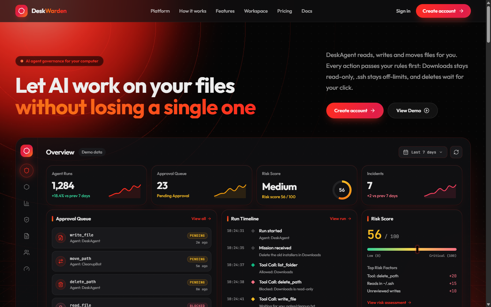

# DeskWarden

**Let AI agents work on your files, under your rules.**

DeskWarden is a policy gateway that sits between an AI agent and your computer. Every tool call the agent makes is checked against your rules before anything happens. Risky actions wait for your approval, and every step goes into an append-only audit log.



## Features

- **Tool rules.** Set each tool to allow, ask first, or block. Tools without a rule are denied.
- **Folder rules.** Mark folders read-only, ask first, or off-limits. When a tool rule and a folder rule disagree, the stricter one wins.
- **Human approval.** Held calls wait in a queue until you approve, reject, or escalate them. After 10 minutes they are rejected automatically.
- **Audit log.** Every request, decision, and rule change is recorded. Database triggers block updates and deletes.
- **DeskAgent.** A built-in agent powered by the OpenAI Responses API. Give it a mission ("tidy my Downloads") and it works through the gateway like any other agent.
- **Bring your own agent.** Generate an agent key and send tool calls from any agent over HTTP.
- **Accounts with email verification.** Signup sends a 6-digit code over SMTP. Passwords are hashed with scrypt, sessions use HttpOnly cookies, and repeated failed logins lock the account.
- **Live console.** A dashboard shows the approval queue, run timeline, audit events, and per-agent stats.

## How it works

```
Your agent ──POST /api/tool-calls──▶ your rules ──▶ allowed | blocked | pending
     ▲                                                          │
     └──── GET /api/tool-calls/:id (poll) ◀── you: approve | reject | escalate
```

DeskAgent goes through the same path. When it needs to delete a file, it asks the gateway, waits for your decision, and runs the tool only if the call is allowed or approved.

## Quick start

You need **Node.js 24.2+**. The server uses only Node built-ins: `node:http`, `node:sqlite`, and `node:crypto`.

```bash
npm install
cp .env.example .env.local    # add your keys (see Configuration)
npm run server                # API on http://127.0.0.1:8787
npm run dev                   # UI on http://localhost:5173/deskwarden/
```

Open `http://localhost:5173/deskwarden/signup` and:

1. **Create an account.** If SMTP is configured, enter the code from your email.
2. **Check your guardrails.** New accounts start with `.ssh` and `AppData` off-limits, `Downloads` read-only, reads allowed, and writes, moves, and deletes set to ask first.
3. **Give DeskAgent a mission** in Mission control and approve its changes as they come in.

## Configuration

Put these in `.env.local`. It is git-ignored, and only the server reads it.

| Variable | Required | Purpose |
| --- | --- | --- |
| `OPENAI_API_KEY` | to run DeskAgent | Server-side only. Never prefix it with `VITE_`, or it ships to the browser |
| `OPENAI_MODEL` | no | Default `gpt-6-luna` |
| `AGENT_ROOT` | no | The only folder DeskAgent may touch. Default: your home folder. **Set it to a narrow folder.** |
| `SMTP_USER`, `SMTP_PASS` | no | Turns on email codes at signup. For Gmail, use an [App Password](https://support.google.com/accounts/answer/185833) |
| `SMTP_HOST`, `SMTP_PORT` | no | Default `smtp.gmail.com` and `465` (implicit TLS) |
| `PORT`, `DB_PATH` | no | Default `8787` and `agentops.db` |

Without SMTP, signup creates the account straight away and the server logs a warning.

## Connect your own agent

Generate a key in **Settings**, then ask the gateway before each tool call:

```bash
curl -X POST http://127.0.0.1:8787/api/tool-calls \
  -H "authorization: Bearer $AGENT_KEY" \
  -d '{"agent":"MyAgent","tool":"write_file","args":{"path":"notes/todo.txt","content":"hi"}}'
# {"id":7,"status":"pending","reason":"Needs your approval"}

curl http://127.0.0.1:8787/api/tool-calls/7 -H "authorization: Bearer $AGENT_KEY"
# poll until status is "approved" or "rejected"
```

Agent keys can only submit and read tool calls. They cannot change rules or read the dashboard.

## API

| Endpoint | Auth | Purpose |
| --- | --- | --- |
| `POST /api/auth/signup` `{email, password}` | none | Create an account, or email a code when SMTP is on (`202`) |
| `POST /api/auth/verify` `{email, code}` | none | Finish signup with the emailed code |
| `POST /api/auth/login`, `/logout` | none | Start or end a session |
| `POST /api/tool-calls` `{agent, tool, args}` | agent key | Submit a call for a decision |
| `GET /api/tool-calls/:id` | agent key or session | Read a call's status |
| `POST /api/tool-calls/:id/decision` `{decision}` | session | `approved`, `rejected` or `escalated` |
| `GET /api/policies`, `PUT` / `DELETE /api/policies/:tool` | session | Read or change tool rules |
| `GET /api/folders`, `PUT` / `DELETE /api/folders` `{path, action?}` | session | Read or change folder rules: `readonly`, `approve`, `block` |
| `POST /api/settings/agent-key` | session | Generate or rotate the agent key (shown once) |
| `POST /api/agent-runs` `{task}`, `GET /api/agent-runs/:id` | session | Run DeskAgent and read its steps |
| `GET /api/me`, `GET /api/dashboard?hours=168` | session | Account info; queue, audit, stats, latest run |

Every tool call, run, rule, and audit event belongs to one account, and every query is scoped to that account.

## Safety rails

No rule can turn these off:

- DeskAgent cannot touch anything outside `AGENT_ROOT`.
- DeskWarden's own folder, which holds the database that decides every approval, is always off-limits.
- Links and junctions are resolved before rules are checked, so a shortcut cannot reach a protected folder. Changing a parent folder counts as changing every protected folder inside it.
- `delete_path` moves files to `AGENT_ROOT/.agentops-trash` instead of deleting them. To restore a file, move it back.
- The server listens on `127.0.0.1` only.

**Privacy:** file names and contents that DeskAgent reads are sent to OpenAI as part of the task.

## Development

```bash
npm test          # server tests; uses a scripted model and a fake mailer, never calls OpenAI or SMTP
npm run build     # typecheck + production build into dist/
```

```
server/index.ts   gateway, accounts, rules, DeskAgent loop
server/mail.ts    minimal SMTP client for signup codes
src/              React + Tailwind UI (landing page, console, mission control, guardrails, settings)
```

## Known limits

- Runs as a single process. Login lockouts and pending signup codes are held in memory and reset on restart.
- Session cookies have no `Secure` flag, so they work over `http://localhost`. Add it before serving over HTTPS.
- SMTP supports implicit TLS (port 465) only. STARTTLS on port 587 is not supported.
- A static host such as GitHub Pages can serve the landing page and demo console, but accounts and DeskAgent need the local backend.

## License

[MIT](LICENSE)
